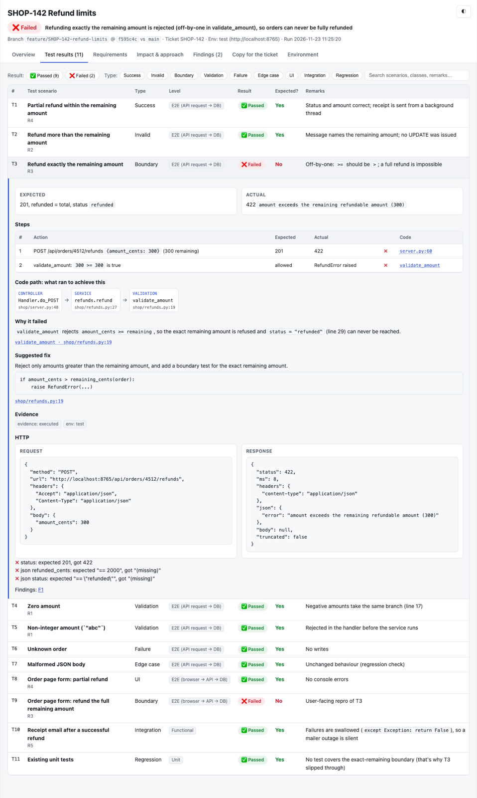
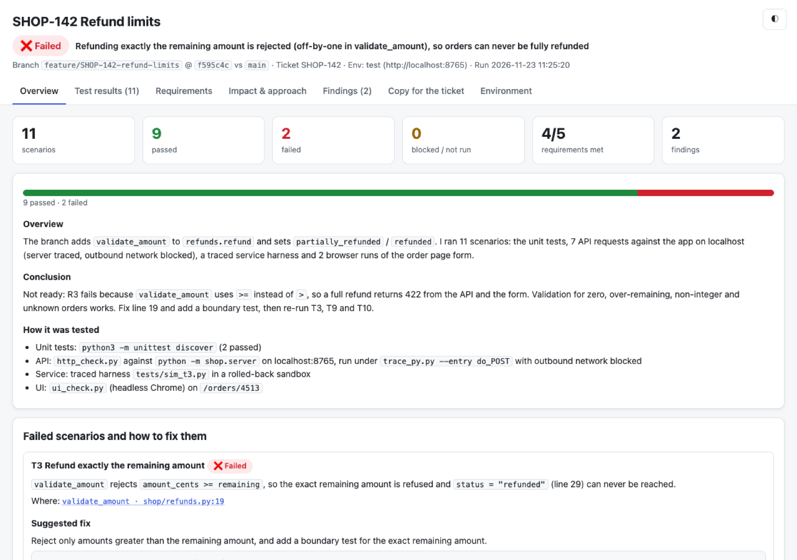
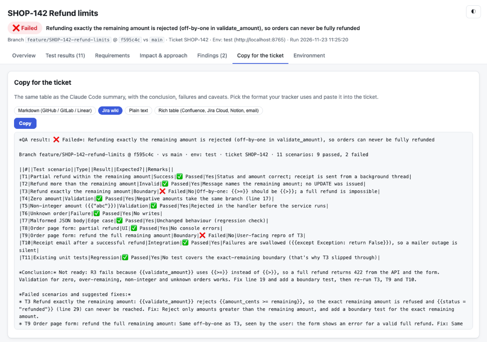
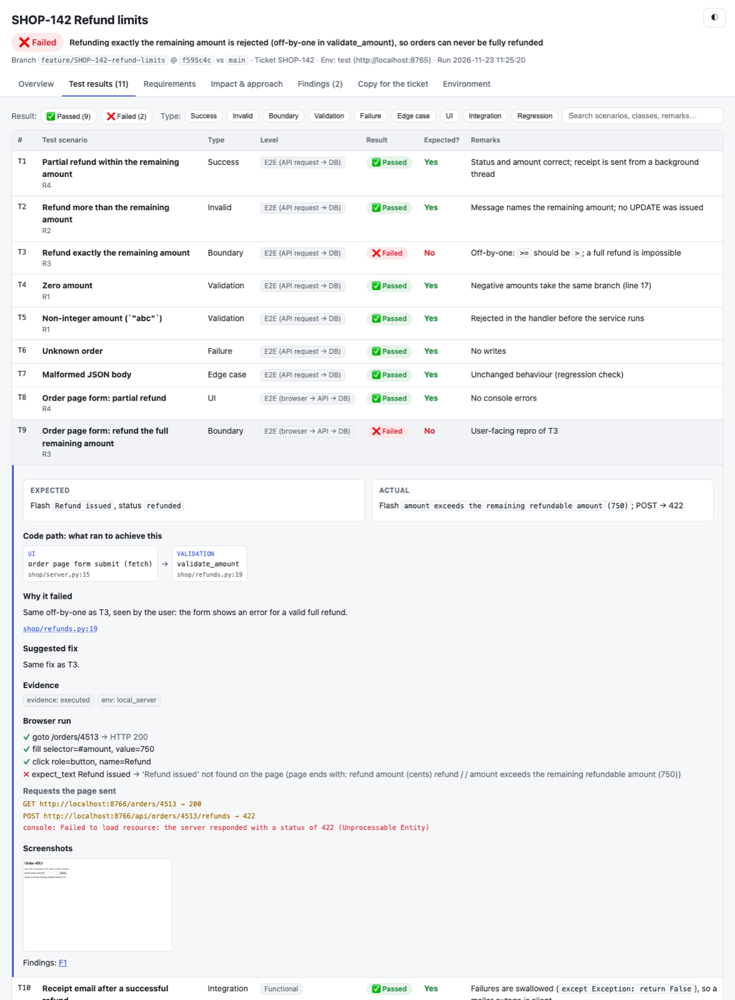
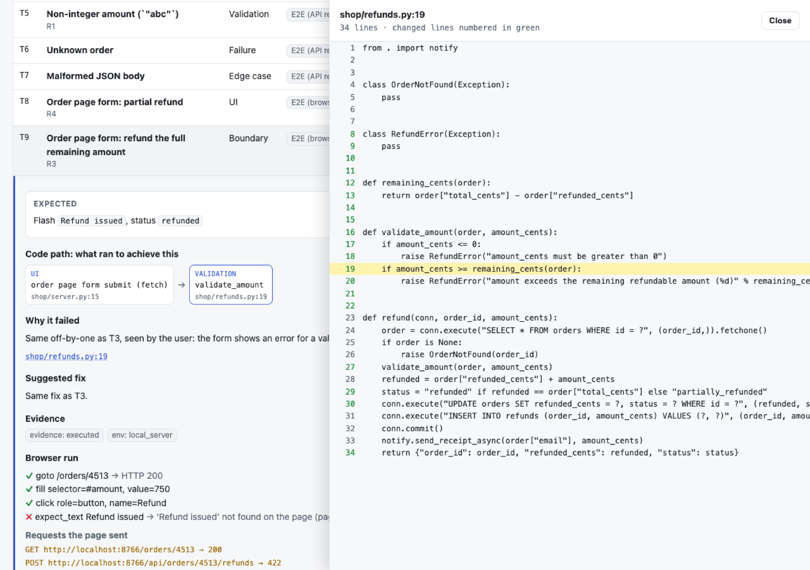

# claude-code-qa: headless E2E and functional QA of your branch with Claude Code

[](https://github.com/rewin0087/claude-code-qa#install)
[](LICENSE)

**`/qa` is a QA agent skill and plugin for [Claude Code](https://claude.com/claude-code).** Type `/qa`, paste the ticket on the next lines, and it QAs the **current git branch** against it:

1. It reads what the branch changed and learns what that change impacts: **endpoints, UI forms, services, models, the database, callbacks, background jobs and external APIs**.
2. It decides how each part must be tested: **browser E2E, API E2E, functional, unit or data**.
3. It plans **success, valid, invalid, validation, boundary, failure and edge-case** scenarios from the acceptance criteria and the code's branches.
4. It **runs them** in your test environment or against the app on localhost, using your test runner, real HTTP requests, a headless browser and a runtime tracer.
5. It **pin-points the classes and methods** each scenario ran through.
6. It marks every scenario **passed or failed**, says whether the outcome was the **expected** one, and adds **remarks** and **fix suggestions** for failures.

You get a results table in the chat, and an **HTML report** with a **Copy for the ticket** section, so manual QA can paste the same table into the ticket.

It runs on your existing Claude Code session, in the terminal, VS Code or JetBrains. There is no API key or server to set up. The scripts use only the Python standard library. Browser E2E uses Playwright, either the one your project already has or Python Playwright, installed only after you agree.



## Features

- **Branch-aware.** It diffs the branch against its base (auto-detected: main, master or develop), including uncommitted and untracked work. It lists the commits, the changed symbols, and an **impact map**: each change's layer, what it does (validation, DB writes, transactions, async jobs, callbacks, external HTTP, forms, UI → API calls, auth, feature flags), the **routes and entry points that reach it**, its callers, and the existing tests that cover it.
- **The right test level for each change.**
  - A changed form gets a **headless-browser E2E** that follows the request into the API.
  - An endpoint, or code reached from one, gets an **API E2E** through real requests.
  - A job, callback or external client gets a **functional** test with jobs run inline and external calls stubbed or blocked.
  - A migration gets a **data** check.
  - Anything that needs a human gets precise **manual steps**.
- **Ticket-driven scenarios.**
  - The acceptance criteria (bullets, checklists, Given/When/Then) become requirements R1…, and every one is covered.
  - Each branch in the changed code gets a scenario on each side.
  - Boundaries (`>` vs `>=`), missing, blank and wrong-typed input, not found, permission denied, double submit, external failures and timeouts are tested too.
  - Without a ticket, it infers the expected behaviour from the code and commits, and says so.
- **Real evidence.**
  - `run_tests.py` runs your runner (RSpec, pytest, Jest, Vitest, Go, PHPUnit, Django, Playwright, Cypress…) and keeps the log, summary and JUnit cases.
  - `http_check.py` sends JSON and form requests to localhost with status, JSON-path, body, header and timing assertions. It keeps cookies across requests and reuses saved values (`{{token}}`).
  - `ui_check.py` drives a headless browser (fill, click, select, expect text or URL), asserts the **form → API request** and its status, and records console errors and screenshots.
- **Code path per scenario.** The Python and Ruby/Rails tracers record which app methods ran, in order, with file:line, call counts and which ones raised. They also record per-line data changes, SQL, and outbound HTTP, which is blocked and recorded. Other stacks get the path from test output and reading.
- **Judged like a QA would.**
  - Every scenario is **Passed, Failed, Blocked or Not run**, with **Expected?** (Yes, No or Partly) and a one-line **remark**.
  - Failures name the file, line and value that's wrong, plus a concrete **fix** and the test that would have caught it.
  - Findings cover problems that aren't one scenario's fault, such as a missing test, silent error handling or missing authorization.
  - The verdict is passed, passed with caveats, failed or blocked.
- **Made for the ticket.** The report's **Copy for the ticket** section has the results table, conclusion, failures and caveats as **Markdown** (GitHub, GitLab, Linear), **Jira wiki**, **plain text**, or a **rich table** to paste into Confluence, Jira Cloud, Notion or email.
- **Safe by default.**
  - Tests run in the test environment, or against the app on **localhost** only. The HTTP and browser runners refuse other hosts, and the test runner refuses production env vars and remote DB URLs.
  - Outbound network is blocked under the tracer.
  - Running anything asks you first, and it never edits your code. Throwaway tests live in the git-ignored `.qa/` folder.

## Install

### As a Claude Code plugin (recommended)

```text
/plugin marketplace add rewin0087/claude-code-qa
/plugin install qa@rewin0087-qa
```

From a shell: `claude plugin marketplace add rewin0087/claude-code-qa && claude plugin install qa@rewin0087-qa`.

Claude Code namespaces plugin commands, so the plugin runs as **`/qa:qa`**. Update it with `claude plugin update qa@rewin0087-qa`.

### As a standalone skill (plain `/qa`)

For every project:

```bash
git clone https://github.com/rewin0087/claude-code-qa.git ~/.claude/skills/qa
```

Or for one project only, clone it into `<repo>/.claude/skills/qa`. Update it with `git -C ~/.claude/skills/qa pull`.

**Requirements:** Python 3.8+ (standard library only) and git. The Ruby tracer needs Ruby 2.6 or later. Browser E2E needs your project's Playwright, Cypress or Capybara, or Python Playwright (`pip install playwright`), which can use your installed Google Chrome.

## Usage

```text
/qa
SHOP-142 Refund limits
Acceptance criteria
- Refund amount must be greater than 0
- A refund cannot exceed the remaining refundable amount; the API returns 422 with a clear message
- Refunding exactly the remaining amount is allowed and sets the status to `refunded`
- The customer receives a receipt email after a successful refund
```

Everything after `/qa`, on the same line or the next ones, is the ticket. Some other forms:

```text
/qa                                    # no ticket: expected behaviour inferred from the code (flagged as a caveat)
/qa #128                               # fetch the issue with gh / glab
/qa https://github.com/acme/shop/issues/128
/qa docs/tickets/SHOP-142.md
/qa --url http://localhost:3000 <ticket>        # test against the app you already have running
/qa --base develop --path app/billing <ticket>  # compare with develop, QA only app/billing
/qa --static <ticket>                  # plan + assess by reading; run nothing
/qa <ticket> -- log in as admin@example.com / use the :with_items order factory
```

| Option | Meaning |
|---|---|
| `--base <branch>` | Base to compare with (default: auto-detect) |
| `--committed-only` | Ignore uncommitted and untracked work |
| `--path <dir>` | Only QA changes under this path (repeatable) |
| `--url http://localhost:<port>` | A running local app to test against |
| `--env test\|dev` | Run in the test env (default) or the local development app/DB (asks first) |
| `--ui` / `--no-ui` | Force or skip browser E2E |
| `--static` | Don't run anything |
| `--scenarios N` | Rough cap on the number of scenarios |
| `--no-open` | Don't open the report |
| `-- text` | Extra instructions |

### What you get in the chat

```markdown
**❌ Failed**: Refunding exactly the remaining amount is rejected (off-by-one in validate_amount)

Branch `feature/SHOP-142-refund-limits` @ `f595c4c` · vs `main` · env: test · ticket SHOP-142 · 11 scenarios: 9 passed, 2 failed

| # | Test scenario | Type | Result | Expected? | Remarks |
|---|---|---|---|---|---|
| T1 | Partial refund within the remaining amount | Success | ✅ Passed | Yes | Status and amount correct; receipt sent from a background thread |
| T2 | Refund more than the remaining amount | Invalid | ✅ Passed | Yes | Message names the remaining amount; no UPDATE was issued |
| T3 | Refund exactly the remaining amount | Boundary | ❌ Failed | No | Off-by-one: `>=` should be `>`; a full refund is impossible |
| T4 | Zero amount | Validation | ✅ Passed | Yes | Negative amounts take the same branch (line 17) |
| T9 | Order page form: refund the full remaining amount | Boundary | ❌ Failed | No | User-facing repro of T3 |
| … | | | | | |

**Requirements:** 4 met, 1 not met
**Conclusion:** Not ready: R3 fails because `validate_amount` uses `>=` instead of `>` …
**Failed, and how to fix:**
- **T3 Refund exactly the remaining amount**: … (`shop/refunds.py:19`) **Fix:** Reject only amounts greater than the remaining amount, and add a boundary test.
**Caveats:** …
Report: file:///…/.qa/feature-shop-142-refund-limits/report.html
```

### The report

| | |
|---|---|
|  |  |
|  |  |

The report has these sections:
- **Overview**: verdict, counts, conclusion, how it was tested, failures and fixes, caveats.
- **Test results**: filterable by result and type, searchable. Each row expands to expected vs actual, steps, the **code path**, side effects (DB, jobs, emails, external calls, events), why it failed, the fix, the command and log, the HTTP request and response, browser steps with the requests the page sent and screenshots, and the recorded trace.
- **Requirements coverage**
- **Impact & approach**: areas, test levels and reasons, changed files with the entry points that reach them and their existing tests.
- **Findings**
- **Copy for the ticket**
- **Environment**: where it ran, and the branch commits.

It's a single self-contained file that works in light and dark mode. Click any `file:line` to see the code.

## How it works

```text
/qa + ticket
  │
  ├─ prepare.py ── branch diff vs base ─► changed files, symbols, commits
  │                impact map ─────────► layer · signals · routes · entry points · callers · tests
  │                tooling ────────────► test runners · Playwright/Cypress/Capybara · dev servers · tracers
  ├─ ticket.py ─── acceptance criteria ─► requirements R1…Rn
  │
  ├─ Claude reads the change outward to its entry points and inward to DB, callbacks, jobs, external calls
  ├─ plans scenarios: success · valid · invalid · validation · boundary · failure · edge case · regression
  │
  ├─ runs them (after you OK the commands)
  │    run_tests.py ─ throwaway specs/tests with your runner → runs/<id>.json, logs/
  │    trace_py.py / trace_rb.rb ─ code path, SQL, blocked outbound HTTP → trace/<id>.json
  │    http_check.py ─ API E2E on localhost → runs/http.json
  │    ui_check.py ─── browser E2E on localhost → runs/ui.json, screens/
  │
  ├─ judges: passed/failed · expected? · remarks · failure line + fix · findings · verdict
  └─ render.py ── validates qa.json ─► report.html · summary.md (chat) · ticket comment
```

Output goes to `<repo>/.qa/<branch>/`, which is added to `.git/info/exclude`:

```text
meta.json changes.json impact.json tooling.json ticket.md ticket.json
tests/   throwaway specs, harnesses, http.json / ui.json specs
runs/    run_tests / http_check / ui_check results
logs/    full test output
trace/   tracer logs
screens/ browser screenshots
qa.json  the QA result (schema: references/qa-schema.md)
report.html summary.md ticket-comment.md
```

### Files

```text
SKILL.md                    the workflow Claude follows
references/qa-schema.md     the qa.json format and rules
templates/report.html       the report (vanilla JS, no CDN)
scripts/
  prepare.py ticket.py run_tests.py http_check.py ui_check.py trace_digest.py render.py   CLIs
  trace_py.py trace_rb.rb   standalone runtime tracers (Python sys.settrace / Ruby TracePoint)
  qakit/                    the logic, one concern per module (see qakit/__init__.py)
```

## Related

- [claude-code-review](https://github.com/rewin0087/claude-code-review): `/branch-review` reviews the branch's code against the ticket.
- [claude-code-investigate](https://github.com/rewin0087/claude-code-investigate): `/investigate` traces and simulates one flow and reproduces bugs.

A typical loop is to run `/branch-review` on the code, `/qa` on the behaviour, and `/investigate` on whatever fails.

## License

MIT
